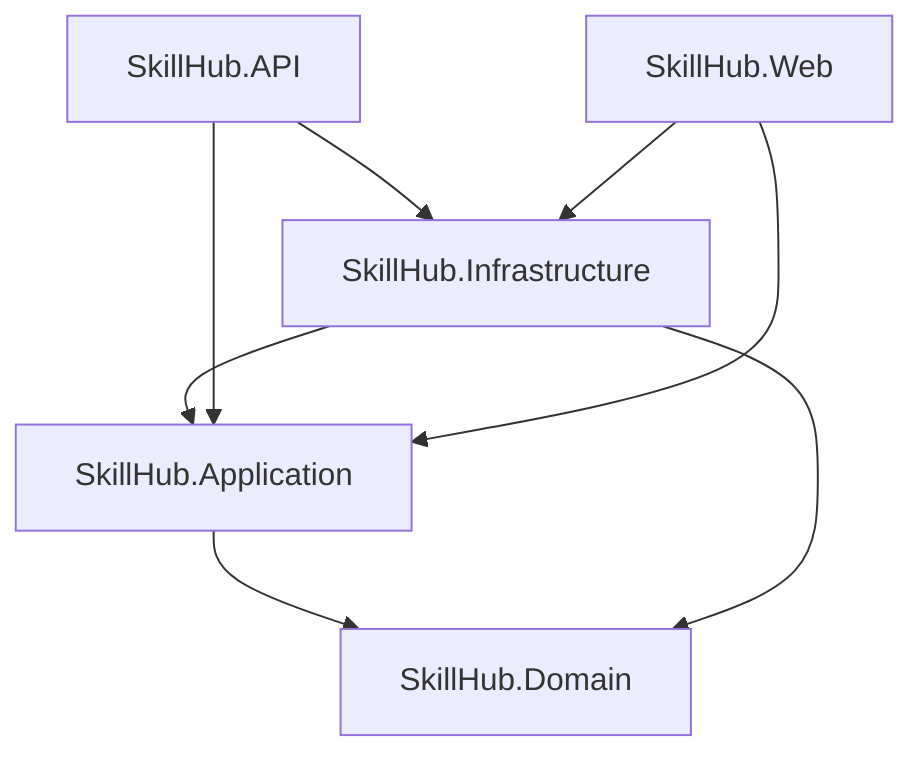

# SkillHub — Training Center Workshop & Enrollment Platform

SkillHub is a enterprise-grade web application and RESTful API designed for managing training workshops, instructor assignments, participant enrollments, attendance certifications, and analytical reporting. Built with **.NET 8** adhering strictly to **Clean Architecture** and **Domain-Driven Design (DDD)** principles.

---

## 🏛️ Architecture Overview

The solution is divided into distinct, decoupled layers according to the Clean Architecture paradigm:

```
SkillHub/
├── src/
│   ├── Core/
│   │   ├── SkillHub.Domain/            # Domain entities, value objects, exceptions, repository interfaces
│   │   └── SkillHub.Application/       # DTOs, use cases, domain service contracts
│   ├── Infrastructure/
│   │   └── SkillHub.Infrastructure/    # EF Core DbContext, Identity, Migrations, Repositories, PDF/Excel services
│   └── Presentation/
│       ├── SkillHub.API/               # RESTful API controllers, JWT auth, Swagger/OpenAPI documentation
│       └── SkillHub.Web/               # MVC Razor web application with responsive UI for participants
└── tests/
    └── SkillHub.Domain.UnitTests/      # Comprehensive unit tests for domain invariants and business rules
```

### Dependency Flow


---

## 🚀 Technology Stack

- **Framework**: .NET 8 (C# 12)
- **Database & ORM**: Microsoft SQL Server & Entity Framework Core 8
- **Security & Identity**: ASP.NET Core Identity & JWT Bearer Tokens (HMAC-SHA256)
- **Document Generation**: QuestPDF 2024.12 for PDF certificates
- **Spreadsheet Processing**: EPPlus 8.0 for data seeding and batch Excel enrollments
- **Web UI**: ASP.NET Core MVC, Razor Pages, Bootstrap 5.3, Bootstrap Icons, Plus Jakarta Sans typography
- **Testing**: xUnit, FluentAssertions, Moq

---

## 📋 Business Rules & Domain Invariants

SkillHub guarantees high data integrity through strict business rule validation:

1. **Workshop Invariants**:
   - Start date/time must be strictly in the future at the moment of creation.
   - End date/time must be after the start date/time.
   - Capacity must be strictly positive (`> 0`).
   - Workshop code must be unique (e.g., `FOT-001`, `COC-002`).

2. **Enrollment Rules**:
   - **Capacity Check**: Active enrollments cannot exceed the workshop capacity.
   - **No Duplicates**: A participant cannot have two active enrollments for the same workshop.
   - **No Schedule Overlaps**: A participant cannot enroll in a workshop whose time window `[Start, End]` overlaps with another active enrollment.
   - **Future Only**: Enrollments are only allowed for workshops scheduled in the future.
   - **Re-enrollment**: If an enrollment was cancelled, the participant is allowed to enroll again provided slots and schedule availability permit.

3. **Cancellation Policy**:
   - **Participant**: Can only cancel their enrollment with at least **24 hours** prior to the workshop's start time.
   - **Employee**: Can cancel any enrollment at any time without time restrictions.
   - Cancellations record the timestamp (`CancelledAt`) and the actor (`CancelledBy`).

---

## 🛠️ Getting Started & Setup

### Prerequisites
- [.NET 8 SDK](https://dotnet.microsoft.com/download/dotnet/8.0)
- [Microsoft SQL Server](https://www.microsoft.com/sql-server) or LocalDB / Express instance

### 1. Clone & Configure
Clone the repository and ensure your connection string is properly configured in:
- `src/Presentation/SkillHub.API/appsettings.json`
- `src/Presentation/SkillHub.Web/appsettings.json`

Example connection string:
```json
{
  "ConnectionStrings": {
    "DefaultConnection": "Server=localhost\\TEW_SQLEXPRESS;Database=SkillHubDb;Trusted_Connection=True;MultipleActiveResultSets=true;TrustServerCertificate=True"
  }
}
```

### 2. Apply Migrations & Seed Data
On application startup, `DbSeeder` automatically ensures the database exists, runs pending EF Core migrations, and preloads default data from `SkillHub_Data.xlsx`:
- 6 Instructor accounts (Employee role)
- 30 Participant accounts (Participant role)
- 15 Initial future workshops

To apply migrations manually via CLI:
```bash
dotnet ef database update --project src/Infrastructure/SkillHub.Infrastructure --startup-project src/Presentation/SkillHub.API
```

### 3. Database SQL Script (Backup & Restoration)
A full SQL export script containing the complete database schema (tables, constraints, indexes) and seeded data is included at the root of the repository:
- `SkillHub_Database_Export.sql`

You can execute this script directly in SQL Server Management Studio (SSMS), Azure Data Studio, or via `sqlcmd`:
```bash
sqlcmd -S localhost\TEW_SQLEXPRESS -E -i SkillHub_Database_Export.sql
```

### 4. Run the Applications

#### Option 1: RESTful API (SkillHub.API)
```bash
dotnet run --project src/Presentation/SkillHub.API
```
- Interactive Swagger UI available at: `http://localhost:5247/swagger` (or configured port).

#### Option 2: Participant Web Application (SkillHub.Web)
```bash
dotnet run --project src/Presentation/SkillHub.Web
```
- Browse workshops, register, login, enroll, download PDF certificates, and manage cancellations through a responsive web interface.

### 4. Run Unit Tests
```bash
dotnet test
```
- **39 unit tests** verifying domain invariants, enrollment overlap logic, capacity bounds, and cancellation rules with 100% pass rate.

---

## 👥 Seeded Credentials

### Instructor Accounts (Role: `Employee`)
| Full Name | Email | Password | Specialty |
| :--- | :--- | :--- | :--- |
| Andrés Mejía | `andres.mejia@correo.com` | `Instructor2026*` | Fotografía |
| Camila Torres | `camila.torres@correo.com` | `Instructor2026*` | Cocina |
| Lucía Gómez | `lucia.gomez@correo.com` | `Instructor2026*` | Oratoria |
| Mateo Morales | `mateo.morales@correo.com` | `Instructor2026*` | Diseño |
| Sofía Vargas | `sofia.vargas@correo.com` | `Instructor2026*` | Fotografía |
| Valentina Ríos | `valentina.rios@correo.com` | `Instructor2026*` | Cocina |

### Sample Participant Accounts (Role: `Participant`)
Participants from `SkillHub_Data.xlsx` are seeded with the default password:
- `Participant2026*`

---

## 🌐 API Reference Summary

### Authentication (`/api/v1/auth`)
- `POST /api/v1/auth/register` — Register a new participant account.
- `POST /api/v1/auth/login` — Authenticate and receive a signed JWT token.

### Workshops (`/api/v1/workshops`)
- `GET /api/v1/workshops` — List all future workshops with real-time available slots.
- `GET /api/v1/workshops/{id}` — Retrieve detailed workshop information.
- `POST /api/v1/workshops` — Create a new workshop (*Employee only*).
- `GET /api/v1/workshops/{id}/enrollments` — List attendees for a workshop (*Employee only*).

### Enrollments (`/api/v1/enrollments`)
- `POST /api/v1/enrollments` — Enroll current participant into a workshop (*Participant only*).
- `GET /api/v1/enrollments/mine` — View current participant's enrollments (*Participant only*).
- `PATCH /api/v1/enrollments/{id}/cancel` — Cancel an enrollment (*Participant within 24h or Employee anytime*).
- `POST /api/v1/enrollments/import` — Batch enroll participants from an Excel spreadsheet (*Employee only*).
- `GET /api/v1/enrollments/{id}/certificate` — Download PDF enrollment certificate.

### Reports (`/api/v1/reports`)
- `GET /api/v1/reports/top-workshops` — Retrieve top 3 workshops by active enrollment count (*Employee only*).

---

## 👨‍💻 Author Information

- **Name**: Joseph Bolivar
- **Clan**: C# / .NET Clan


